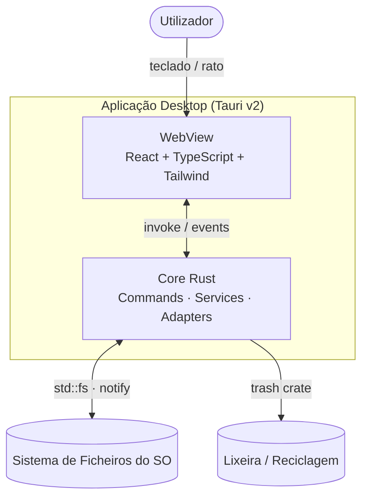

# File Manager (Tauri) — Visão Geral da Arquitetura

> **Produto:** um file manager desktop cross‑platform inspirado no Total Commander
> **Princípio central:** dois painéis, teclado‑first, operações de ficheiros seguras e rápidas.
> **Estado:** especificação/arquitetura (pré‑implementação).

---

## 1. Objetivo

Construir uma aplicação desktop leve e rápida que ofereça a experiência do Total Commander
(painéis duplos, teclas de função, navegação por teclado, operações em lote sobre ficheiros)
com uma base tecnológica moderna, segura e extensível.

## 2. Stack decidido

| Camada | Tecnologia | Versão alvo | Notas |
|---|---|---|---|
| Shell desktop | **Tauri** | `2.9.x` (estável atual) | WebView do sistema + core em Rust |
| Core backend | **Rust** | stable (MSRV ≥ 1.77) | `std::fs`, `tokio`, `notify`, `trash` |
| Frontend UI | **React + TypeScript** | React 19 / TS 5.x | Componentização e tipagem forte |
| Build frontend | **Vite** | 6.x/7.x | Dev server rápido + HMR |
| Estilo | **Tailwind CSS** | 4.x | Densidade visual tipo TC |
| Estado frontend | **Zustand** | 5.x | Stores pequenos por domínio |
| Virtualização | **TanStack Virtual** | 3.x | Listas com 100k+ entradas |
| IPC | `@tauri-apps/api` | v2 | `invoke` + `listen` (eventos) |

> Versões a reconfirmar no *scaffold* com `npm create tauri-app@latest` e `cargo tauri info`;
> o protocolo de atualidade (Framework Currency) exige revalidação no arranque do projeto.

## 3. Princípios de arquitetura

1. **Clean / Hexagonal** — domínio puro no Rust; filesystem atrás de *ports* (trait) e *adapters*.
2. **Fronteiras modulares** — frontend não conhece detalhes de SO; backend não conhece a UI.
3. **Security‑first** — validação de caminhos, lixeira por omissão, confirmações destrutivas, CSP restritiva.
4. **Performance** — listagem assíncrona, virtualização de UI, streaming para diretórios enormes.
5. **Extensibilidade** — novos *adapters* (SFTP, arquivos, cloud) sem tocar no domínio nem na UI.
6. **Sem segredos** — nenhuma credencial/valor de ambiente hardcoded; caminhos resolvidos em runtime.

## 4. Índice da documentação

| Documento | Conteúdo |
|---|---|
| [`01-specification.md`](01-specification.md) | Requisitos funcionais e não‑funcionais, paridade com Total Commander, âmbito |
| [`02-architecture.md`](02-architecture.md) | Arquitetura em camadas, C4, módulos e regras de dependência |
| [`03-data-flows.md`](03-data-flows.md) | Fluxos de dados, contratos IPC, catálogo de eventos |
| [`04-project-structure.md`](04-project-structure.md) | Estrutura de pastas modular (Rust hexagonal + React) |
| [`05-security-performance.md`](05-security-performance.md) | Capabilities Tauri, CSP, validação de caminhos, performance |
| [`06-roadmap.md`](06-roadmap.md) | Fases MVP → v1 e plano de delegação por modo |

> **Backend implementado:** o executável portátil usa **Node SEA** (ver
> [`07-node-portable.md`](07-node-portable.md)) com `server/archiveService.js` (arquivos como
> pastas, caminhos `zip::`/`tar::`) e `server/remoteService.js` (FTP/FTPS/SFTP/WebDAV, caminhos
> `remote::`).

## 5. Diagrama de alto nível

