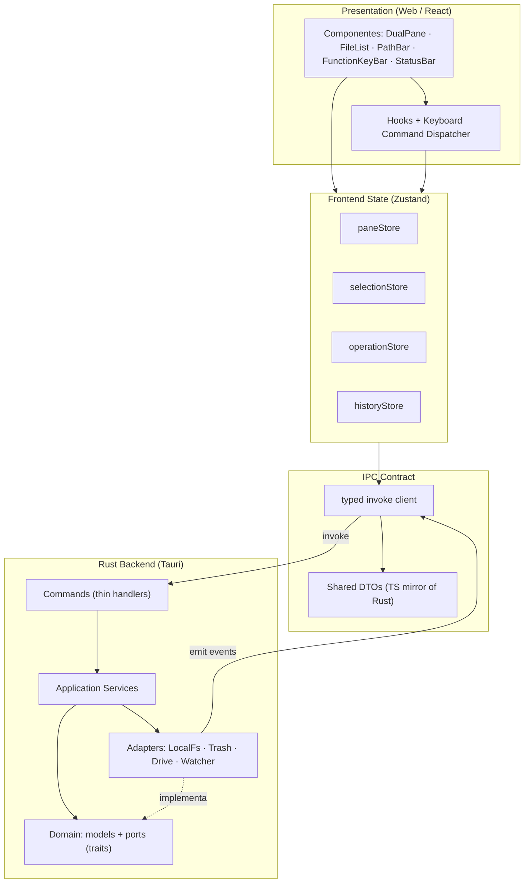
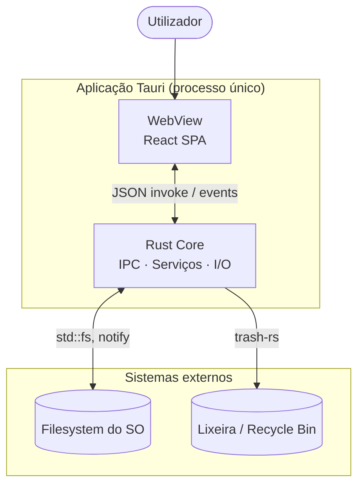
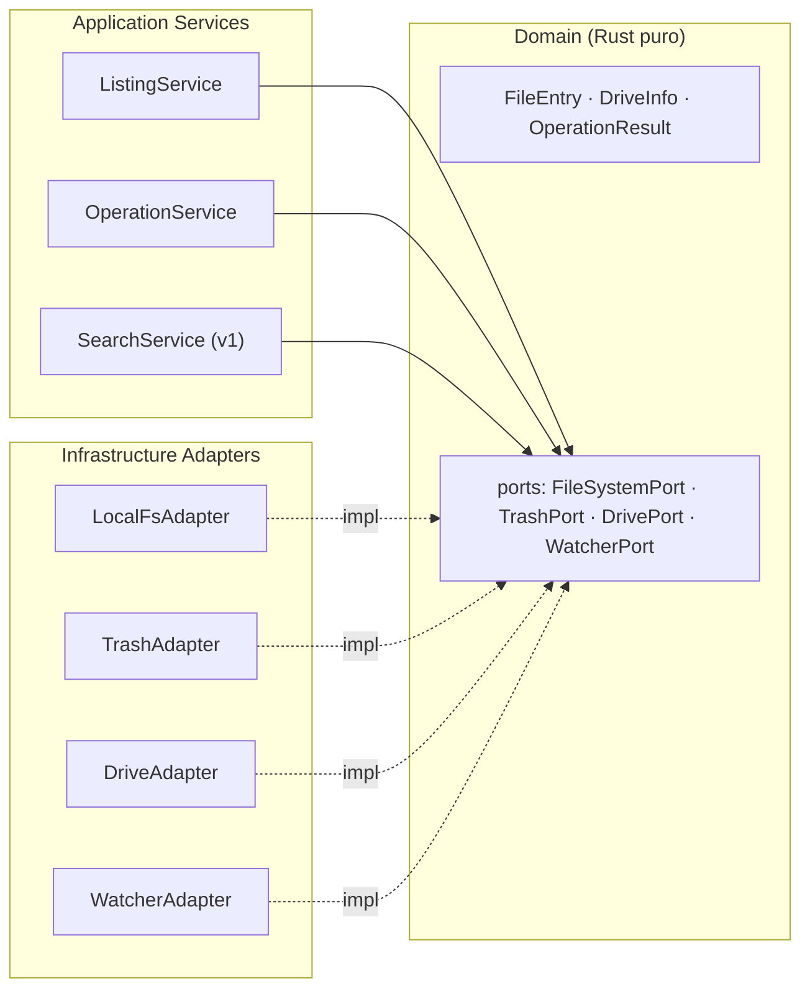
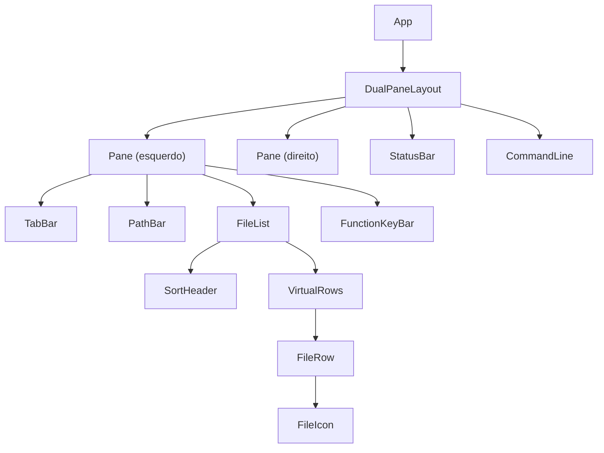

# Arquitetura Detalhada

> Estilo: **Clean Architecture / Hexagonal** no Rust + **feature modular** no React.
> Regra de ouro: as dependências apontam **sempre para dentro** (domínio não conhece infraestrutura).

---

## 1. Vista em camadas

## 2. Vista de contentores (C4 nível 2)

## 3. Backend hexagonal (ports & adapters)

O domínio declara *traits* (ports). Os adapters implementam‑nos. Serviços orquestram casos de uso.
Isto permite adicionar SFTP/arquivos/cloud **sem alterar** domínio, serviços ou UI.

## 4. Frontend — árvore de componentes

## 5. Fronteiras e responsabilidades

| Módulo | Responsabilidade | Não pode depender de |
|---|---|---|
| `domain` (Rust) | Modelos, regras, *traits* (ports) | infraestrutura, tauri, UI |
| `services` (Rust) | Casos de uso (listar, copiar, mover…) | tauri/ui, apenas ports |
| `adapters` (Rust) | I/O concreta (`std::fs`, `notify`, `trash`) | UI, componentes React |
| `commands` (Rust) | Handlers `#[tauri::command]` finos: validam + delegam | lógica de negócio |
| `ipc` (TS) | Wrappers tipados de `invoke`/`listen` | componentes |
| `state` (TS) | Estado de UI por domínio (Zustand) | detalhes de SO |
| `components` (TS) | Renderização e interação | `invoke` direto (usa `ipc` via stores/commands) |

## 6. Regras de dependência

1. `domain` é **puro**: sem `tauri`, sem `tokio`, sem `std::fs`.
2. `services` dependem **apenas** de `domain::ports` (injeção via `Box<dyn Port>` ou genéricos).
3. `commands` são a **única** porta de entrada do frontend; são finos e sem regra de negócio.
4. Componentes React nunca chamam `invoke` diretamente — passam por `ipc` + `state` + `commands`.
5. Eventos do backend → `ipc` → stores; a UI reage ao estado, não a payloads crus.

## 7. Extensibilidade (como crescer sem reescrever)

- **Novo backend de ficheiros (SFTP/WebDAV):** novo *adapter* que implementa `FileSystemPort`;
  a UI e os serviços não mudam.
- **Arquivos (zip/tar):** `ArchiveAdapter` + `FileSystemPort` virtual.
- **Sincronização/cloud:** `CloudAdapter` + fila de operações.
- **Temas/plugins:** tema via Tailwind tokens; plugins futuros via API de comandos.

> Implementado no backend portátil (Node SEA): `server/archiveService.js` (arquivos como pastas,
> caminhos `zip::`/`tar::`) e `server/remoteService.js` (FTP/FTPS/SFTP/WebDAV, caminhos
> `remote::`). Ver [`07-node-portable.md`](07-node-portable.md).
