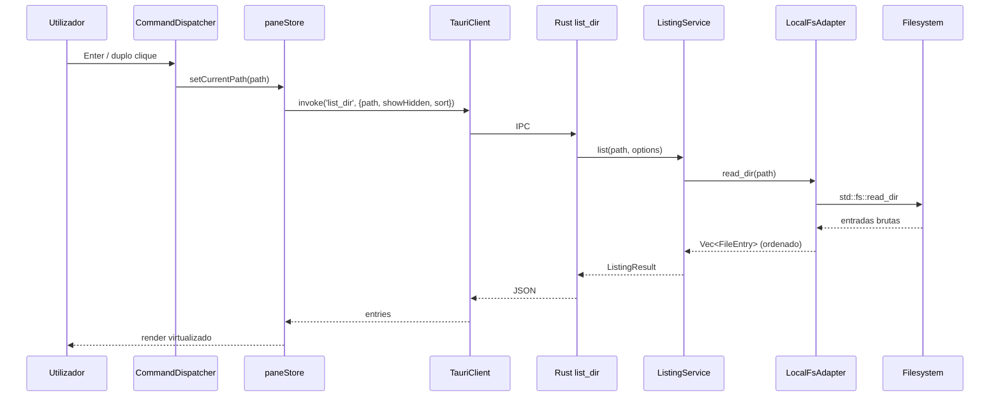
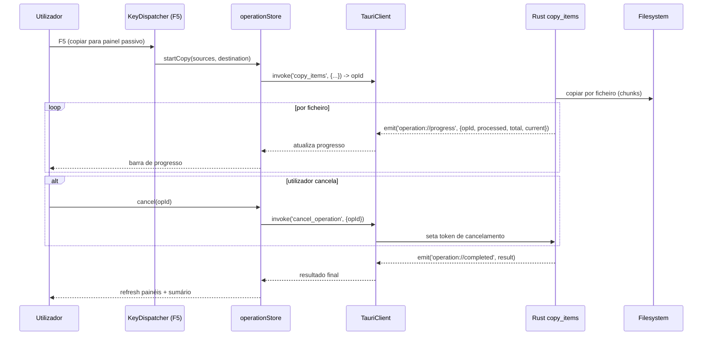
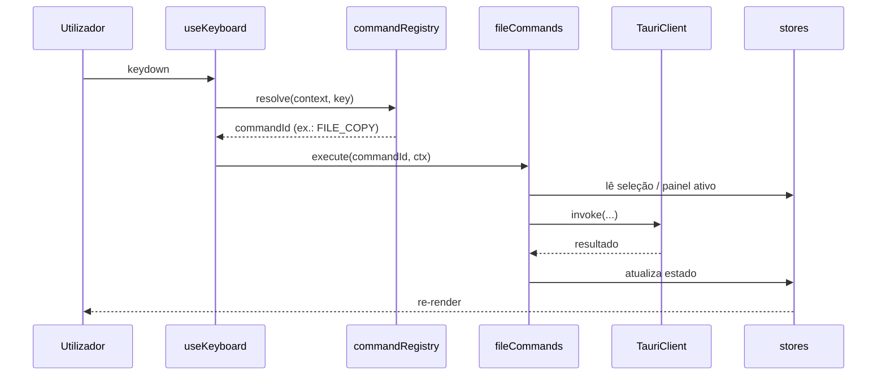

# Fluxos de Dados e Contratos de Integração

> Todos os fluxos frontend↔backend passam por `invoke` (pedido/resposta) e `listen` (eventos).
> Nenhum segredo ou caminho absoluto hardcoded: caminhos chegam do runtime do SO/utilizador.

---

## 1. Contrato IPC — catálogo de comandos

| Comando | Pedido | Resposta | Notas |
|---|---|---|---|
| `list_dir` | `{ path, showHidden, sort: {field, dir} }` | `{ parent: string?, entries: FileEntry[] }` | Ordenação aplicada no Rust |
| `get_metadata` | `{ path }` | `FileEntry` | Metadados de um item |
| `copy_items` | `{ sources: string[], destination, options }` | `OperationResult` | Emite `operation://progress` |
| `move_items` | `{ sources: string[], destination, options }` | `OperationResult` | Emite progresso |
| `delete_items` | `{ paths: string[], useTrash: bool }` | `OperationResult` | Lixeira por omissão |
| `rename_item` | `{ path, newName }` | `FileEntry` | Valida conflito |
| `create_dir` | `{ parent, name }` | `FileEntry` | — |
| `get_drives` | `{}` | `DriveInfo[]` | Diferenças por SO |
| `get_home_dir` | `{}` | `string` | Path resolver do Tauri |
| `search` | `{ root, query, options }` | `string` (id) | Resultados por evento (v1) |
| `watch_dir` | `{ path }` | `string` (subscriptionId) | Eventos `fs://changed` (v1) |
| `cancel_operation` | `{ opId }` | `bool` | Token de cancelamento |

> O backend implementado é o **portátil Node SEA** (ver [`07-node-portable.md`](07-node-portable.md)),
> que expõe estas operações como rotas HTTP e acrescenta `archiveService`/`remoteService` com
> caminhos virtuais `zip::`/`tar::`/`remote::`.

### DTOs partilhados (espelho Rust ↔ TS)

```jsonc
// FileEntry
{ "name": "report.pdf", "path": "/abs/path/report.pdf", "isDir": false,
  "isSymlink": false, "size": 1048576, "modified": "2026-11-08T15:00:00Z",
  "extension": "pdf", "attributes": "A" }

// DriveInfo
{ "path": "/", "label": "Macintosh HD", "kind": "fixed", "total": 0, "free": 0 }

// OperationResult
{ "opId": "uuid", "success": 12, "failed": 0, "errors": [], "cancelled": false }
```

> Estratégia de tipos: gerar TS a partir do Rust com `ts-rs` (fonte única de verdade) ou manter
> `ipc/types.ts` sincronizado manualmente no MVP. Preferir `ts-rs` (ver roadmap).

## 2. Fluxo: abrir / navegar num diretório



## 3. Fluxo: cópia com progresso e cancelamento



## 4. Fluxo: despacho de teclado (comando)



## 5. Catálogo de eventos (backend → frontend)

| Evento | Payload | Emitido quando |
|---|---|---|
| `fs://changed` | `{ path: string }` | Watcher deteta alteração no diretório |
| `operation://progress` | `{ opId, processed, total, current }` | Durante cópia/mover/delete |
| `operation://completed` | `OperationResult` | Fim de operação (sucesso/cancelado) |
| `search://result` | `{ searchId, entry }` | Streaming de resultados (v1) |
| `search://done` | `{ searchId, total }` | Pesquisa concluída (v1) |

## 6. Estratégia de sincronização de estado

- **Fonte de verdade do filesystem:** sempre o backend. O frontend é cache de apresentação.
- **Invalidação:** após qualquer operação que escreva (copy/move/delete/rename/mkdir) ou evento
  `fs://changed`, o pane afetado refaz `list_dir`.
- **Debounce** de watcher: agrupar rajadas de eventos (ex.: 300–500 ms) por diretório.
- **Operações otimistas:** apenas para `selectionStore` (não toca no disco); nunca para mutações.

## 7. Tratamento de erros

- Erros Rust → `Result<T, AppError>` serializável (`code`, `message`, `path?`).
- Frontend mapeia `code` para mensagem i18n + ação sugerida.
- Falhas parciais em lote: `OperationResult.errors[]` lista itens falhados sem abortar os restantes.
